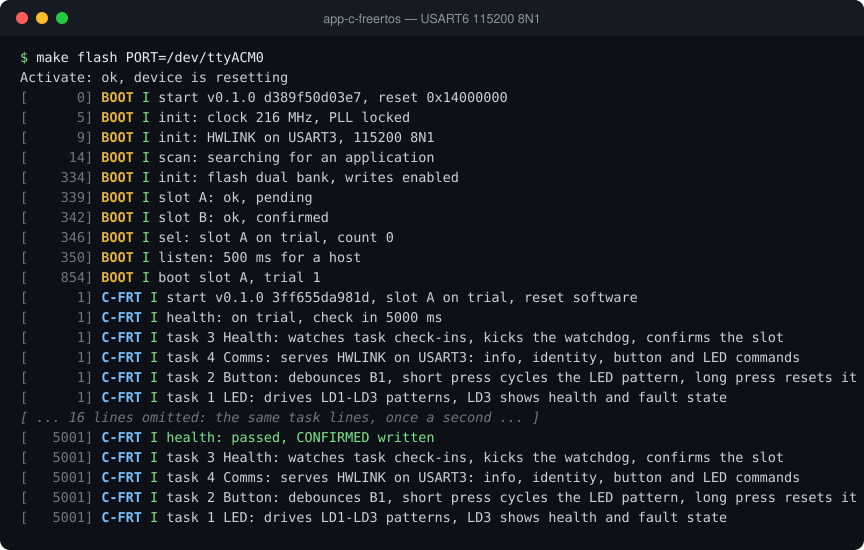

# app-c-freertos

A FreeRTOS demo application in C for the NUCLEO-F767ZI that runs under the A/B bootloader. It drives the on-board LEDs in selectable patterns, reads the user button, talks to the desktop GUI over UART with the HWLINK protocol, supervises its tasks with the watchdog and confirms itself to the bootloader after a health check. It is the reference implementation that the Rust and Zephyr versions match, and the template for starting a new product application on this platform.

## Debug terminal

The debug log from a reset on a NUCLEO-F767ZI (USART6, 115200 8N1), recorded from the board. [Watch it replay line by line](https://soccentric-stm32.github.io/#app-c) on the project page.



<details>
<summary>Plain text</summary>

```console
$ make flash PORT=/dev/ttyACM0
Activate: ok, device is resetting
[      0] BOOT I start v0.1.0 d389f50d03e7, reset 0x14000000
[      5] BOOT I init: clock 216 MHz, PLL locked
[      9] BOOT I init: HWLINK on USART3, 115200 8N1
[     14] BOOT I scan: searching for an application
[    334] BOOT I init: flash dual bank, writes enabled
[    339] BOOT I slot A: ok, pending
[    342] BOOT I slot B: ok, confirmed
[    346] BOOT I sel: slot A on trial, count 0
[    350] BOOT I listen: 500 ms for a host
[    854] BOOT I boot slot A, trial 1
[      1] C-FRT I start v0.1.0 3ff655da981d, slot A on trial, reset software
[      1] C-FRT I health: on trial, check in 5000 ms
[      1] C-FRT I task 3 Health: watches task check-ins, kicks the watchdog, confirms the slot
[      1] C-FRT I task 4 Comms: serves HWLINK on USART3: info, identity, button and LED commands
[      1] C-FRT I task 2 Button: debounces B1, short press cycles the LED pattern, long press resets it
[      1] C-FRT I task 1 LED: drives LD1-LD3 patterns, LD3 shows health and fault state
[ ... 16 lines omitted: the same task lines, once a second ... ]
[   5001] C-FRT I health: passed, CONFIRMED written
[   5001] C-FRT I task 3 Health: watches task check-ins, kicks the watchdog, confirms the slot
[   5001] C-FRT I task 4 Comms: serves HWLINK on USART3: info, identity, button and LED commands
[   5001] C-FRT I task 2 Button: debounces B1, short press cycles the LED pattern, long press resets it
[   5001] C-FRT I task 1 LED: drives LD1-LD3 patterns, LD3 shows health and fault state
```

</details>

## Features

- Runs from either bootloader slot, linked at `0x0800C000`
- Seven LED patterns on LD1/LD2: OFF, ON, BLINK, HEARTBEAT, FAST, CHASE and MORSE_SOS
- Pattern periods from 50 to 5000 ms in 10 ms steps
- LD3 reserved for fault and failed-health indication
- B1 button with 30 ms debounce: short press cycles patterns, long press restores defaults
- HWLINK over USART3 with COBS framing, CRC-32 and a FlatBuffers verifier
- Commands: Hello, Ping, GetStatus, SetLed, SetLedAll, ClearFault, SetBaud, Reset and EnterBootloader
- Unsolicited ButtonEvent messages and replay of the last reply on a repeated sequence number
- Four FreeRTOS tasks: Health, Comms, Button and LED
- Health task supervises task check-ins and is the only watchdog feeder
- Writes the CONFIRMED record after a successful trial health check
- Fail-health build option to test bootloader rollback
- Reset cause and a no-init fault record with CFSR, HFSR, MMFAR, BFAR, PC and LR
- Task stack high-water marks and heap statistics in the status reply
- Static allocation only; nothing is allocated after the scheduler starts
- Build fails if the image exceeds 128 KB flash or 64 KB RAM
- Produces a ready-to-flash bootloader image (`demo.img`)
- Reproducible Docker build environment

## Build and run

```bash
scripts/docker-dev.sh build   # build the stm32-dev container image once
scripts/build.sh              # build inside the container
make flash                    # upload build/demo.img through the bootloader
make help                     # list all targets
```

## Repository layout

```
board/            board headers (pins, FreeRTOSConfig, HAL config)
ld/               linker script
protocol/         HWLINK FlatBuffers schema (hwlink.fbs)
third_party/      vendored flatcc runtime
src/
  app/            entry point, RTOS hooks, BOOT hand-over record
  tasks/          Health, Comms, Button and LED FreeRTOS tasks
  drivers/        clock, time base, cache/MPU, watchdog and USART3 drivers
  services/       logging, fault record, reset cause, identity, flash
                  confirmation and CRC32
  protocol/       HWLINK framing and the flatcc static-arena port
  generated/      flatcc output for protocol/hwlink.fbs (checked in)
```

Headers are included relative to `src/` (for example
`#include "tasks/led_task.h"`), so `src/` stays the single include root and the
folder name tells you which layer a module belongs to.

## Related projects

- [bootloader](https://github.com/soccentric-stm32/bootloader) — A/B bootloader with UART update, CRC32 checks, trial boot and rollback
- [app-c-zephyr](https://github.com/soccentric-stm32/app-c-zephyr) — Demo application in C on Zephyr RTOS
- [app-rust-freertos](https://github.com/soccentric-stm32/app-rust-freertos) — Demo application in Rust on Embassy
- [app-rust-zephyr](https://github.com/soccentric-stm32/app-rust-zephyr) — Demo application in Rust on Zephyr RTOS
- [validation-firmware](https://github.com/soccentric-stm32/validation-firmware) — HWVAL hardware validation firmware
- [validation-gui](https://github.com/soccentric-stm32/validation-gui) — HWVAL Studio: desktop GUI for tests, updates and flashing
- [factory-station](https://github.com/soccentric-stm32/factory-station) — HWVAL Factory: end-of-line test and provisioning station
- [soccentric-stm32.github.io](https://github.com/soccentric-stm32/soccentric-stm32.github.io) — Project website

## License

Released under the [MIT License](LICENSE) © 2026 Sandesh Ghimire. You are free
to use, modify and ship it in your own products.

Contributions are welcome. Fork the repository, make your change on a branch and
open a pull request. Bug reports, ideas and improvements are all appreciated.
